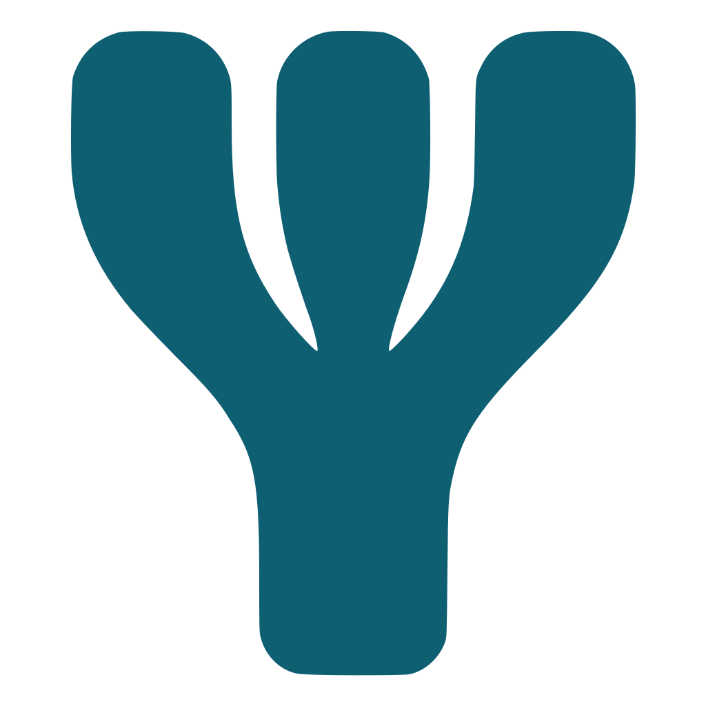
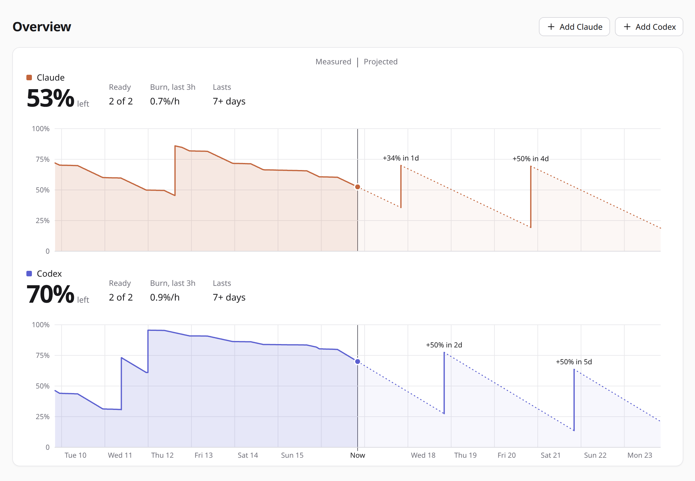

<p align="center">
  
</p>

<h1 align="center">conflux</h1>

<p align="center">Pool your Claude Code and Codex subscriptions across all of your computers.</p>

<p align="center">
  <a href="#quick-start"><strong>Quick start</strong></a> ·
  <a href="docs/install.md">Install guide</a> ·
  <a href="docs/commands.md">Commands</a> ·
  <a href="docs/troubleshooting.md">Troubleshooting</a>
</p>

<picture>
  <source media="(prefers-color-scheme: dark)" srcset="assets/dashboard-dark.png">
  
</picture>

<p align="center"><sub>The dashboard shows how much quota each pool has left. The solid line is the past week. The dotted line is the forecast, with each coming reset.</sub></p>

One always-on machine, the **hub**, holds your Claude and ChatGPT account logins. Claude Code and Codex on your other machines send their requests through it, so every machine draws from the same pool of accounts.

## What you get

- **Less wasted quota.** New sessions start on the available account whose weekly limit resets soonest.
- **Automatic failover.** When an account runs out, the next request goes to one that still has room.
- **Stable sessions.** A session stays on one account, so its prompt cache keeps working.
- **One dashboard.** See each pool's quota, your machines, and recent requests from any device on your tailnet.
- **Optional thread sync.** `conflux sync on` copies a machine's threads to the hub, where you can search them. It's off by default.

> [!WARNING]
> Pooling subscriptions may break your providers' terms and could get your accounts banned. conflux is unofficial. It logs in through Claude Code's and Codex's own OAuth clients, so either provider can break it at any time. Use it only for your own work on your own machines, and use Claude subscriptions only from Claude Code.

## Quick start

You need:

- [Tailscale](https://tailscale.com) on every machine.
- Claude Code or Codex on each machine you work from.
- One machine that stays on at home to be the hub. Linux is best. Don't send its traffic through another VPN or an exit node.

The installer supports Linux x64 and ARM64 with systemd, macOS on Apple silicon, and Windows x64. It installs conflux as a background service and points Claude Code and Codex at it. `conflux leave` undoes that.

**1. Install on the hub.**

```sh
curl -fsSL https://raw.githubusercontent.com/Byntham/conflux/main/install.sh | sh -s -- self
```

On Windows, in PowerShell:

```powershell
irm https://raw.githubusercontent.com/Byntham/conflux/main/install.ps1 | iex
conflux join self
```

The last line it prints is the dashboard's address. Run `conflux` to print it again. If the installer changed your PATH, open a new terminal.

**2. Add your accounts.** On the hub, run one command per subscription.

```sh
conflux login claude    # a Claude subscription
conflux login codex     # a ChatGPT subscription
```

Each one prints a link. Open it in a browser signed in to that account. For Claude, the browser then shows a connection error. That is expected. Paste the whole URL from the address bar into the terminal.

**3. Add your other machines.** Skip this if you only work on the hub. There are two ways.

- *From the dashboard.* Open Machines, click "Find machines", then click "Install". This works for Mac and Linux machines that the hub can ssh to without a password.
- *On the machine itself.* Install conflux, then link it to the hub:

  ```sh
  curl -fsSL https://raw.githubusercontent.com/Byntham/conflux/main/install.sh | sh
  conflux join
  ```

  For Windows, see the [install guide](docs/install.md#on-the-machine-itself).

**4. Restart your sessions.** Restart Claude Code and Codex on every machine, including the hub. Your next message shows up on the dashboard's Requests tab. If it doesn't, see [Troubleshooting](docs/troubleshooting.md).

The [install guide](docs/install.md) covers guests, the Mac menu bar app, updates, building from source, and uninstalling.

## Everyday commands

| Command | What it does |
| --- | --- |
| `conflux status` | Show accounts, usage, and cooldowns |
| `conflux disable <account>` | Stop using an account. `enable` brings it back |
| `conflux off` | Use this machine's own logins, for example when the hub is down. `on` undoes it |
| `conflux update` | Update every online machine that is behind |
| `conflux leave` | Stop conflux on this machine and restore Claude Code's and Codex's settings |

`<account>` is an ID from `conflux status`. [Commands](docs/commands.md) explains every command, including how to move the hub to another machine.

## Security

- Every machine signed in to Tailscale as you can use and manage your accounts and read synced transcripts. So can any program on the hub itself.
- Machines of other Tailscale users, and tagged machines, join as guests. They can send requests only after you approve them.
- The hub stores account tokens unencrypted. Protect it like a password manager.
- `conflux leave` keeps the tokens. Before you retire a hub, run `conflux remove <account>` for each account. A hub move leaves a copy in a `retired-*` folder on the old hub. Delete it once the move has worked.

## Documentation

- [Install guide](docs/install.md)
- [Commands](docs/commands.md)
- [Configuration](docs/configuration.md)
- [Troubleshooting](docs/troubleshooting.md)
- [Architecture](docs/architecture.md), for contributors

## License

[MIT](LICENSE)
