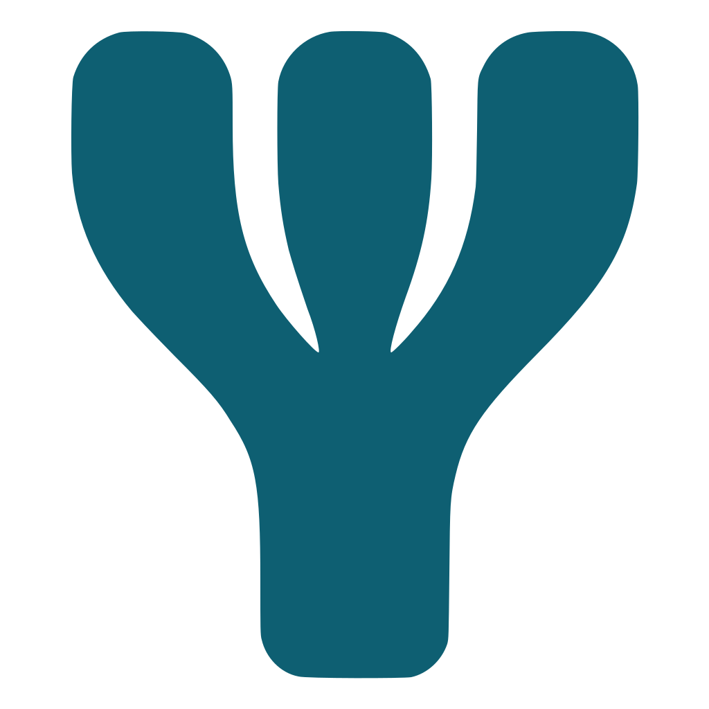

# conflux

conflux lets all of your computers share a pool of Claude and ChatGPT subscriptions.

You log in to your accounts once, on one always-on machine at home. Claude Code and Codex on your other machines then send their requests through it.

## What you get

- **Less wasted quota.** New sessions start on an available account whose weekly limit resets soonest.
- **Automatic failover.** When an account runs out, conflux sends that request to one that still has room and keeps the session on it.
- **Stable sessions.** A session stays on one account, which keeps its prompt cache working.
- **A dashboard.** See every account's limits, your machines, and recent requests from any device on your Tailscale network.
- **Optional thread history.** Collect Claude Code and Codex threads from the machines you choose, to read and search in one place.

> [!WARNING]
> Pooling subscriptions this way may break your providers' terms and could get your accounts banned. conflux is unofficial and logs in through Claude Code's and Codex's own OAuth clients, so either provider can break it at any time. It's for one person's own work on their own machines. Don't use it to serve other people, and only use Claude subscriptions from Claude Code.

## Before you start

You need:

- Claude Code or Codex on each machine you work from. The hub doesn't need them.
- [Tailscale](https://tailscale.com) on every machine, on a tailnet that holds only your own devices, with MagicDNS on (the default). conflux has no login of its own, so anyone who can reach the hub can use your accounts.
- One machine to be the **hub**. It should stay on and stay at home. Don't send its internet traffic through another VPN or a Tailscale exit node, so the providers see one home IP address.

conflux runs on Linux with systemd, macOS on Apple silicon, and Windows x64. A hub on macOS or Windows runs only while you're signed in. On Linux, the installer tries to keep it running after you log out and tells you if it can't.

## Set up the hub

On the machine you've picked, run:

```sh
curl -fsSL https://raw.githubusercontent.com/Byntham/conflux/main/install.sh | sh -s -- self
```

On Windows, in PowerShell:

```powershell
irm https://raw.githubusercontent.com/Byntham/conflux/main/install.ps1 | iex
conflux join self
```

If the installer says it changed your PATH, open a new terminal before continuing.

Next, log in. Run one command per account you want in the pool, and skip a provider you don't use.

```sh
conflux login claude
conflux login codex
```

Each command prints a link you can open in any browser signed in to that account. For Claude, approve access. The browser then shows a connection error, which is expected. Paste the URL from its address bar into the terminal. For Codex, enter the code it shows you and wait.

The dashboard is now at `http://127.0.0.1:8317` on the hub. From your other devices, use `http://<hub>:8317`, where `<hub>` is the hub's name in `tailscale status`.

If you use Claude Code or Codex on the hub itself, restart any open sessions. They now go through conflux too.

## Add your other machines

The dashboard's "Add a machine" panel has these commands with your hub's name filled in.

```sh
curl -fsSL https://raw.githubusercontent.com/Byntham/conflux/main/install.sh | sh -s -- <hub>
```

On Windows, in PowerShell:

```powershell
irm https://raw.githubusercontent.com/Byntham/conflux/main/install.ps1 | iex
conflux join <hub>
```

conflux now runs in the background, and it has edited Claude Code's and Codex's settings to send their requests through the hub. Sessions that are already open need a restart to pick this up.

To check that it worked, start a new session on that machine and send a message. It appears under "Recent requests" on the dashboard.

On a system without a prebuilt binary, build it with Rust instead:

```sh
cargo install --git https://github.com/Byntham/conflux
conflux join <hub>    # use self on the hub
```

## Update conflux

When a new release is out, the dashboard marks each machine that is behind. Click "Update all" there, or run this on any machine:

```sh
conflux update              # every machine that is online
conflux update <machine>    # one machine
```

Each machine downloads the release and starts it next to the running version. The new version takes every new request. The old one finishes the requests it already has, then exits. A Codex WebSocket closes when its current turn ends, and Codex opens a new one for the next turn.

A machine that is off during an update stays on its old version. The dashboard keeps it marked until you update it.

A system without a prebuilt binary cannot update this way. Run `cargo install` on it again.

## Everyday commands

| Command | What it does |
| --- | --- |
| `conflux status` | Show accounts, usage, and cooldowns |
| `conflux update` | Update every online machine to the latest release |
| `conflux login claude` or `codex` | Add an account, or log one in again |
| `conflux disable <account>` | Stop using an account. `enable` brings it back |
| `conflux remove <account>` | Delete an account from the hub |
| `conflux off` | Point this machine back at its own logins. `on` undoes it |
| `conflux leave` | Stop conflux and restore Claude Code's and Codex's settings. The binary and account data stay |

If the hub is ever down, run `conflux off` on the machine you're using and restart your tool. If you've never logged in to Claude Code or Codex on that machine, log in directly first.

## Move the hub to another machine

The new machine needs conflux installed. Any machine you've already added is ready. Your logins move with the hub, and your other machines follow on their own.

```sh
conflux hub move-code                               # on the current hub
conflux hub take-over <old-hub> --code <code>       # on the new machine, within 10 minutes
conflux join <new-hub>                              # back on the old machine
```

The first command prints the second one for you. Wait a minute before the third, with the old hub still running, so your other machines can switch and HTTP responses already streaming there can finish. Codex WebSocket sessions close when the move starts. A machine that was off during the move can run `conflux join <new-hub>` itself. If a move gets stuck before it finishes, `conflux hub resume` on the old hub puts it back in service.

## Optional features

**Thread history.** Run `conflux sync on` on each machine you want to collect from, to copy its Claude Code and Codex transcripts to `~/conflux/transcripts` on the hub. The dashboard's Threads tab lists and searches them, and you can point an agent at the folder to look for patterns. It's off by default because transcripts contain everything your agents have read. `conflux sync off` stops it. Copies already on the hub stay until you delete them.

**Extra usage.** conflux won't use a Claude account's paid extra usage unless you allow it with `conflux overage <account> on`, and then only when no other account has room.

**T3 Code.** Run `conflux t3-key` on the hub, then add the URL and key under Settings > Providers > Usage providers in [T3 Code](https://t3.codes) to see your pooled limits there.

## Security

Anyone who can reach the hub can use and manage your accounts and read synced transcripts. Account tokens are stored unencrypted in files on the hub, so protect that machine like you would a password manager. `conflux leave` keeps them, so run `conflux remove <account>` first if you're done with a hub. After a hub move, the old hub keeps a copy in a `retired-*` folder under `~/.local/share/conflux`. Delete it once the move has worked.

## License

[MIT](LICENSE)
